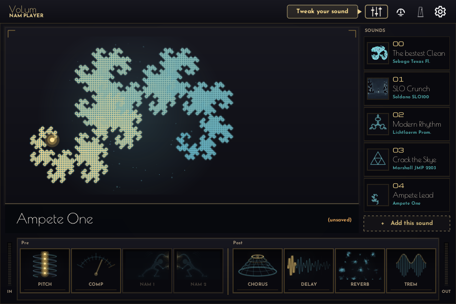

# VoLum on Linux

Upstream VoLum ships `windows-setup.exe`, `windows-portable.zip` and macOS packages only
([issue #17](https://github.com/guitarlum/VoLum/issues/17) tracks the request, and
`backlog/O1-linux-support-spike.md` is the spike ticket). This folder is the Linux
equivalent of `NeuralAmpModeler/projects/NeuralAmpModeler-vst3.vcxproj`: a CMake project
that builds the **VST3** plug-in natively, with the iPlug 2 graphics backend implemented for
X11 + GLX.

[](https://github.com/dmos42/VoLum/actions/workflows/linux-vst3.yml?query=branch%3Avolum%2Flinux-port)

Status of the port: the audio path, the VST3 wrapper, the editor window, mouse/keyboard
input, in-app menus and text entry, clipboard, cursors and fonts all work, and so does the
standalone: [`volum-app`](#the-standalone-application) is VoLum in a window of its own with no
DAW in the way. The file / folder / colour dialogs are the desktop's own, asked over the
session bus, and the message box is drawn in-app — see
[Dialogs the desktop owns](#dialogs-the-desktop-owns). Three command-line hosts are built
alongside the plug-in: a probe that answers "does the module load and make sound?",
[`volum-live`](#running-volum-without-a-daw), which plays the plug-in straight against ALSA,
and `volum-app`, which is that same engine behind a window and nothing else to type.

The work happens on `volum/linux-port`, which is that repository's default branch:
[`dmos42/VoLum`](https://github.com/dmos42/VoLum). [Issue #8](https://github.com/dmos42/VoLum/issues/8)
is the map — what is already covered by a test, the seven pieces that are missing (one issue
each), and the order to pick them up in. The iPlug 2 half of the port lives on
[`dmos42/iPlug2@volum/linux-port`](https://github.com/dmos42/iPlug2/tree/volum/linux-port),
which is what `.gitmodules` resolves.



Captured headless by the probe harness (`VOLUM_LINUX_CAPTURE` under Xvfb) at 900 x 600: amp
view, rig list, the Pre and Post pedalboards, the header buttons. Fonts, icons, gradients and
the pedal artwork all come through NanoVG, so this is
[`IGraphicsLinux.cpp`](../../iPlug2/IGraphics/Platforms/IGraphicsLinux.cpp) doing on X11 + GLX
what the macOS and Windows backends do. What a still cannot show is the dialogs: the file,
folder and colour prompts are the desktop's own, asked over the session bus
([Dialogs the desktop owns](#dialogs-the-desktop-owns)), and the message box is drawn in-app
by the same platform layer, the way the menus and the text entry are.

## Requirements

Fedora 44 (what the port was developed on). Everything is in the repositories:

```bash
sudo dnf install @development-tools cmake ninja-build clang \
  alsa-lib-devel glib2-devel libX11-devel libglvnd-devel mesa-libGL-devel freetype-devel \
  xcb-util-devel xcb-util-image-devel xcb-util-wm-devel xcb-util-cursor-devel libXcursor-devel \
  xorg-x11-server-Xvfb
```

| package | why |
| --- | --- |
| `@development-tools` | gcc, g++, make, patch, git helpers (GCC 16 is what the code compiles clean on) |
| `cmake`, `ninja-build` | configure and build |
| `clang` | kept as an alternative compiler (`-DCMAKE_C_COMPILER=clang -DCMAKE_CXX_COMPILER=clang++`) |
| `libX11-devel` | the window, events, clipboard, cursors |
| `xcb-util-{image,wm,cursor}-devel`, `libXcursor-devel` | cursor loading and the Xfixes/Xrender headers those pull in |
| `libglvnd-devel`, `mesa-libGL-devel` | GLX + OpenGL 2 for NanoVG (`IGRAPHICS_GL2`) |
| `freetype-devel` | font loading through NanoVG |
| `alsa-lib-devel` | needed by `volum-live` and `volum-app`, the hosts that open the capture and playback streams themselves; the plug-in never touches a device |
| `glib2-devel` | D-Bus, which is how the plug-in asks the desktop for a file, a folder or a colour — without it the module builds with no dialogs at all |
| `xorg-x11-server-Xvfb` | headless X server, only for the probe harness and CI |

Debian/Ubuntu names, for anyone who ports the CI later — not verified on a Debian box:
`build-essential cmake ninja-build libx11-dev libgl1-mesa-dev libfreetype-dev
libxcursor-dev libxcb-util-dev libxcb-image0-dev libxcb-icccm4-dev libxcb-cursor-dev
libasound2-dev libglib2.0-dev libatomic1 xvfb`.

`libatomic1` matters: two 64-bit atomics compile to `__atomic_store`/`__atomic_load` libcalls,
and GCC below 14 does not add `-latomic` on its own. A shared library links fine with an
undefined symbol, so the build stays green and the failure appears when a DAW loads the
bundle — `dlopen ... undefined symbol: __atomic_store`. The CMake project tests that
`-latomic` links and adds it when it does, so Fedora (where GCC passes it for you) and Ubuntu
(where it does not) both work. It cannot use `find_library`: on Fedora the `.so` the linker
needs is under `/usr/lib/gcc`, not in the loader path, so the search returns NOTFOUND.

The VST3 SDK is a vendored dependency of iPlug 2, not a submodule commit you can check out.
If `iPlug2/Dependencies/IPlug/VST3_SDK` is empty, the script clones it into the **current**
directory, so run it from its own folder:

```bash
cd iPlug2/Dependencies/IPlug && bash download-vst3-sdk.sh
```

It deletes the SDK's own `.git` at the end, so its last line (`git checkout README.md`, which
restores the one file iPlug 2 does track in that directory) is resolved against the
*enclosing* repository. That only works inside `iPlug2/Dependencies/IPlug`; run it from the
repo root and the SDK lands at `./VST3_SDK` and the checkout fails.

## Build

```bash
cmake -S NeuralAmpModeler/linux -B build/linux -G Ninja -DCMAKE_BUILD_TYPE=Release
cmake --build build/linux
```

The result is a Steinberg-layout bundle:

```
build/linux/VoLum.vst3/
├── Contents/x86_64-linux/VoLum.vst3.so     # the module
└── Contents/Resources/{fonts,img,VoLumRigs}
```

Three command-line hosts are built next to it, all directly in `build/linux/`:
`volum-vst3-probe`, described under [the probe harness](#the-probe-harness), and `volum-live`
plus `volum-app`, described under [running VoLum without a DAW](#running-volum-without-a-daw).
The last two are the only targets that need ALSA; when its headers are missing the build
prints a warning and leaves them out. `VOLUM_BUILD_PROBE`, `VOLUM_BUILD_LIVE` and
`VOLUM_BUILD_APP` are the switches, all ON.

`-DVOLUM_COPY_RIGS=OFF` skips the 249 bundled `.nam` rigs (the bundle drops from ~83 MB to a
few MB); the plug-in then looks for rigs in the paths listed under [Files VoLum
writes](#files-volum-writes-on-linux).

A debug build keeps `DBGMSG` output (the SDK is always told it is release code, so `NDEBUG`
is what turns iPlug's logging off — see the comment in `CMakeLists.txt`):

```bash
cmake -S NeuralAmpModeler/linux -B build/linux-dbg -G Ninja -DCMAKE_BUILD_TYPE=Debug
```

Ubuntu turns `-D_FORTIFY_SOURCE=3` on for every optimised build; Fedora does not. Bugs only
the fortifier catches — an `snprintf` whose size argument is larger than the room left in the
buffer, which is what happened in iPlug 2's `CurrentTime()` — pass on a Fedora box and abort
the process in CI (`*** buffer overflow detected ***`, exit 134, before a host can even load
the bundle). Compile the way CI does when touching the platform layer:

```bash
cmake -S NeuralAmpModeler/linux -B build/linux-fort -G Ninja \
  -DCMAKE_BUILD_TYPE=Release -DVOLUM_FORTIFY=ON
```

## Install into a DAW

```bash
cmake --install build/linux          # -> ~/.vst3/VoLum.vst3
```

That path is `$HOME/.vst3` on purpose: it is the per-user VST3 folder every Linux host
scans (`VOLUM_INSTALL_DIR` overrides it, e.g. `-DVOLUM_INSTALL_DIR=/usr/local/lib/vst3`).

### The same install puts the standalone where a desktop looks

```
~/.local/bin/volum-app                             the program
~/.local/share/applications/com.github.guitarlum.VoLum.desktop
                                                   its menu entry
~/.local/share/icons/hicolor/*/apps/com.github.guitarlum.VoLum.png
                                                   its icon, six sizes
~/.local/share/metainfo/com.github.guitarlum.VoLum.metainfo.xml
                                                   what a software centre says about it
~/.vst3/VoLum.vst3                                 the bundle the program loads
```

The default prefix is per-user — `~/.local`, which is already on `PATH` on Fedora and
Ubuntu — so building then installing gives a program and a menu entry without root and
without any configuration; `CMAKE_INSTALL_PREFIX` overrides it. The two halves land where
each already looks: `volum-app` searches `~/.vst3` for its bundle
([the standalone](#the-standalone-application)), and the menu entry names `VoLum` as
`StartupWMClass`, which is the `WM_CLASS` the standalone's window publishes — that is what
lets a taskbar group the running window with the entry instead of showing a second,
nameless one.

A packager wants system paths instead: `-DCMAKE_INSTALL_PREFIX=/usr` moves the program,
the entry and the icons to `/usr/bin` and `/usr/share`, and
`-DVOLUM_INSTALL_DIR=/usr/lib/vst3` moves the bundle; `DESTDIR=` then stages the whole
thing into a build root, which is what an RPM, a tarball and an AppImage all do
([issue #4](https://github.com/dmos42/VoLum/issues/4)). Checked both ways here: staged into
a `/usr` root the tree comes out as `/usr/bin/volum-app`,
`/usr/share/applications/com.github.guitarlum.VoLum.desktop` (which
`desktop-file-validate` accepts), six icons under `/usr/share/icons/hicolor` and the
metainfo under `/usr/share/metainfo` — and `appstreamcli validate-tree` on that root is a CI
step, not a hope.

Those three file names are one name. `com.github.guitarlum.VoLum` is the AppStream component
id, and the spec wants it to be the stem of the `.desktop` file, of the icon the entry's
`Icon=` line resolves to, and of the `.metainfo.xml` — an entry whose icon is installed under
another name installs happily and shows a generic picture forever, which is the kind of defect
nothing in a build log sees. The id follows the upstream project so that a Linux build
accepted by `guitarlum/VoLum` later keeps the same identity in people's software centres; the
fork is only what ships one today, which is why the metainfo's bug tracker is the fork's
([issue #14](https://github.com/dmos42/VoLum/issues/14)).

The icon is the artwork the Windows and macOS builds already ship
(`NeuralAmpModeler.ico`, taken at six sizes). VoLum draws its own wordmark inside the
editor but has no icon mark of its own yet, and inventing one in a packaging commit is not
the place to do it.

### Two names for the module

The install puts one real file and one relative link next to it:

    VoLum.vst3/Contents/x86_64-linux/VoLum.vst3.so   Steinberg rule: module named after the bundle
    VoLum.vst3/Contents/x86_64-linux/VoLum.so        -> VoLum.vst3.so, the name JUCE hosts rebuild

[Steinberg's format description](https://steinbergmedia.github.io/vst3_dev_portal/pages/Technical+Documentation/Locations+Format/Plugin+Format.html)
says the shared object and the bundle must have the same name, which is what upstream does on
Windows and macOS. JUCE rebuilds the path itself, as
`Contents/$(uname -m)-linux/<bundle name without .vst3>.so` (`getDLLFileFromBundle` in
`juce_VST3PluginFormat.cpp`), so a bundle carrying only the Steinberg name never reaches
`dlopen` in that family of hosts: Carla 2.5.10 printed `No plugins found` and
`JUCE Assertion failure in juce_VST3PluginFormat.cpp:999` for exactly this reason, and listed
`VoLum`, 2 in / 2 out, 1 MIDI in and 233 parameters as soon as the link existed. Hosts that
instead glob `*.so` in the architecture folder can show VoLum twice; delete `VoLum.so` if that
bothers you.

* **Bitwig Studio** — Options → Audio and MIDI → VST3: make sure `~/.vst3` is in the plug-in
  path list, then rescan.
* **Reaper** — Options → Preferences → Plug-ins → VST: add `~/.vst3` to the VST3 path list.
* **Carla / Ardour / Qtractor / any other VST3 host** — point the plug-in path at `~/.vst3`.

### The host's audio engine on a PipeWire desktop

Finding the module is only half of it; the host also has to reach the audio interface, and on a
PipeWire desktop two of Carla's engines cannot:

* **ALSA** — PipeWire owns the card, so opening it fails. `arecord -D hw:3,0` gives the same
  answer, `Périphérique ou ressource occupé` / `Device or resource busy`.
* **PulseAudio** — the engine Carla picks by default. It only offers playback devices, so an
  instrument attached to the interface never appears as an input at all.
* **JACK** — the one that works: `pipewire-jack` answers that name, Carla joins the PipeWire
  graph, and the interface's own capture ports become Carla's inputs.

Keep Carla's buffer size equal to the quantum PipeWire hands out. With Carla asking for 512 on a
PipeWire running at 1024 the log fills with `Carla assertion failure: "nframes ==
pData->bufferSize" ... v1 512, v2 1024` (`CarlaEngineJack.cpp:2857`); setting 1024 silences it.

**Flatpak hosts cannot see `~/.vst3`** — the sandbox hides your home directory. Grant the
folder to the app (per user, reversible):

```bash
flatpak override --user --filesystem=~/.vst3 studio.kx.carla
flatpak override --user --reset studio.kx.carla     # undo
```

Granting the folder is necessary but not sufficient for a sandboxed host: the Flatpak runtime
carries an older glibc than a Fedora 44 build demands, so that Carla still refuses the module.
See [issue #7](https://github.com/dmos42/VoLum/issues/7) and the portability note in
[Limitations](#limitations); the packaged (native) Carla loads it normally.

## Running VoLum without a DAW

`volum-live` is a host of its own: it opens the ALSA streams itself, loads the same
`VoLum.vst3` module, and puts the plug-in's own window on the screen. Device and period
size are options you hand to the program instead of settings you look for in a host's
dialogs, and no audio server sits between the guitar and the amp. Its messages are in
French; the options are not.

```bash
./build/linux/volum-live --list     # what ALSA can see, then stop
./build/linux/volum-live --check    # negotiate everything, print it, play nothing
./build/linux/volum-live            # editor, in and out on the default device
```

Options worth knowing:

| option | meaning |
| --- | --- |
| `--out DEV`, `--in DEV` | playback and capture devices. `--in` defaults to the device named by `--out`; `--no-in` opens no capture at all |
| `--period N` | frames per ALSA period, which is also the block size handed to the plug-in — 256 by default, which is 5.33 ms at 48 kHz and what a DAW would use |
| `--periods N` | periods kept in flight: 2 by default. Through a sound server the useful number is `period × periods`, which `openStream()` raises to the server's quantum (1024 frames) if the two together come out smaller |
| `--gain X` | input trim before the plug-in, for an interface that records quietly |
| `--in-file F.wav`, `--out-file F.wav` | feed the plug-in from a file, and record its output. Without an `--out`, a WAV in and a WAV out is a plain offline conversion that never opens a card |
| `--param IDX:VAL` | set a plug-in parameter before the first block; `--list-params` prints the indices |
| `--meter N`, `--seconds N`, `--no-ui` | level report every N seconds, run length, skip the window |

The same keys may be written in `~/.config/VoLum/live.conf`, one `key=value` per line, and
the command line wins over the file. Ctrl-C ends a run; so does closing the plug-in's window.

Levels are reported as crest and RMS in dBFS in both directions, with a warning when the
input clips, and the run finishes with a verdict — sound coming out, or an empty output
explained as either a missing signal or an input nobody fed. A run that underruns its
playback buffer says so and suggests `--periods`.

### Straight from the card, or through the audio server

`default` works in both directions and cannot break anything, but PipeWire re-frames the
stream at its own quantum, so the period you asked for is not the period you hear; the
tool says so while opening the stream. The lowest round trip needs the card to yourself,
which means asking the desktop to let go of it for a while:

```bash
systemctl --user stop wireplumber pipewire pipewire-pulse   # frees the card
./build/linux/volum-live --out front:CARD=THR10X,DEV=0 --in front:CARD=THR10X,DEV=0 --period 64
systemctl --user start wireplumber pipewire pipewire-pulse  # the desktop takes it back
```

The numbers say which way to go, and they were not the numbers first expected. Measured on the
real THR10X through `default`, full duplex, editor window open, 8 seconds per run:
`--period 64 --periods 2` underran the playback stream 375 times, and `--period 256
--periods 2` — the block size a DAW would hand the plug-in — underran it 376. Raise the
**buffer** to 1024 frames and that failure mode is gone at every period: `64×16`, `128×8`,
`256×4` and `512×2` each produced the block count a clean run must (6001, 2993, 1501, 751 in
8 seconds) instead of half of it, and over twenty-second runs the underrun count went from
hundreds to between zero and four. The hundreds were the stream being served at half the rate
it asked for, which is what a player calls a guitar cut into pieces; a lone underrun in twenty
seconds is a hiccup nobody reaches for a flag over.

So through a server the parameter that decides is the whole buffer against the server's own
quantum — PipeWire's `clock.quantum`, 1024 frames by default, read it with
`pw-metadata -n settings 0` — not the size of the period. A stream whose buffer is smaller than
that piece is fed in pieces it cannot hold, and no flag on the period fixes it. `openStream()`
holds that floor for server-backed streams and says so as the stream opens ("tampon porte a 4
periodes de 256 images"); a server that answers with less than the floor gets said about too,
rather than left to be discovered by ear. The period itself stays free to choose, and a small
one is still what a directly held card wants.

Which is also the whole story of the crackling AppImage people heard: it asked for 64 frames in
two periods, 128 frames of buffer, in front of a server serving 1024. Nothing in the plug-in and
nothing in the cable was at fault.

Stopping the server also stops the desktop's sound: no video, no browser tab, until the last
line puts it back. Nothing in this port needs that to be permanent.

A card another program holds answers `Device or resource busy`, and the error names both
ways out of it. Nothing else in this port asks you to touch the desktop audio server: that
one step is the price of a few milliseconds.

### What the window costs the audio thread

The plug-in's view runs on its own thread with its own X11 connection — that is
[iPlug 2's Linux platform layer](#layout-of-the-port) — so the audio loop keeps the main
thread and only pumps window events between blocks: redraws do not stall the stream, and
the run stops when the window closes. `--no-ui` leaves the window unopened, for a rack
started from a script.

One thing the platform layer has to remember to say out loud: iPlug 2 plug-ins are told
their editor is open through `OnUIOpen()`, and VoLum uses that handshake to decide whether
to measure levels at all — its `ProcessBlock` steps over the meter work while the flag is
false. Only `IGraphicsWin` called it, so on Linux the window loaded, drew, clicked and ran
the amp with both meter columns dead and no error to show for it. The call now happens
after the control tree is laid out, on the editor's own thread; placed where Windows
places it — inside `OpenWindow`, before that tree exists — it core dumps on the spot,
which is the stack `git log` in iPlug2 records. Two screenshots two seconds apart of a run
with live audio say the rest: before, 0 pixels of the window differ and the columns are
dark; after, 11 363 pixels move and the IN and OUT bars come up lit.

That comparison is a script now, run against the shipped package rather than the build
tree: `test/meter-motion-test.bash` starts the AppImage headless on a throwaway PipeWire
sink — the tone enters through `--in-file`, so no capture card opens and nothing reaches
the speakers — dumps three frames of its window, and counts the lit segments of the two
columns in each. The tone steps loud/quiet every 0.4 s, so a column has a reason to change
height: the AppImage from `v1.3.1-linux.3` reads 44 → 16 → 44 segments for IN and
40 → 16 → 40 for OUT and passes, while the bundle that `~/.vst3` was holding from before
the fix reads 0 segments in both, 0 pixels of the window changing, and fails.

### The standalone application

`volum-app` is the Linux counterpart of the `VoLum.exe` / `VoLum.app` upstream ships: run it
and the amp appears in a window, with no host to configure first. A DAW is told which plug-in
to load and which device to use; this program has to decide both for itself, so those are the
only two things it adds over `volum-live`:

* **which bundle to run** — looked for next to the executable first (`/proc/self/exe`, so the
  build tree and a folder you copied both work), then `~/.vst3`, `$XDG_DATA_HOME/vst3`, and the
  VST3 folders under `/usr`. `./build/linux/volum-app` therefore runs with no install step,
  and `cmake --install build/linux` is enough for a system-wide one. When nothing is found the
  program prints every folder it searched instead of "cannot open file".
* **which device, at which period** — `~/.config/VoLum/app.conf`, the same `key=value` keys as
  `live.conf` (`out=`, `in=`, `period=`, `periods=`, `gain=`, `param=`), so the choice is made
  once and kept. `--help` lists them all. When the output comes out in pieces on a machine
  whose card is shared with a sound server, this file fixes it without a rebuild — a package
  nobody can recompile reads it too:

  ```bash
  echo 'period=512' >> ~/.config/VoLum/app.conf   # 1024 frames of buffer on PipeWire
  ```

The same keys are editable in the window now ([issue #10](https://github.com/dmos42/VoLum/issues/10)):
the standalone's signal tab has an **Audio & MIDI devices...** button, and the panel it opens
lists what ALSA announced (`--list` names, no typing), the input with a **none** row, and the
period presets. A choice is probed first - the device is opened before anything is written -
and a device that refuses is answered by the in-app message box with nothing saved. What the
probe accepts is written to `app.conf` atomically (a temp file and one `rename()`, so keys you
manage by hand, comments included, survive), and the running block loop watches that file:
the stream is reopened on the spot, on the previous settings if the new ones turn out not to
open. The panel reads what the device actually negotiated from the environment when it opens,
so the period row shows the truth, not the wish. A DAW loading the same plug-in never sees
any of it: the panel and its button exist only when `VOLUM_APP_CONF` is in the environment,
which only `volum-app` sets.

The block loop, the ALSA negotiation, the editor window and the shutdown order are literally
`volum-live`'s files — `runHost()` in `live-runner.cpp` — which is the reason both hosts can be
claimed to behave the same: run the same WAV through each and the two output files are
identical byte for byte (the same `sha256 424729f4…` as the pre-split binary). Levels are not
printed by default (`--meter N` still asks for them), and closing the window is the way out.

```bash
./build/linux/volum-app                 # window, default device, settings from app.conf
./build/linux/volum-app --check         # what it would open, without opening it
./build/linux/volum-app --list          # device names to put in app.conf
```

What it deliberately is not: a DAW. One stereo pair in and out, no timeline, no routing, no
MIDI in the host yet ([issue #6](https://github.com/dmos42/VoLum/issues/6)).

### One file you can run: the AppImage

`cmake --install` already lays out everything a package needs, so the package is that tree
plus a mount. `packaging/appimage.bash` stages the install rules into an AppDir, puts
`VoLum.vst3` one level above `bin/` — where the program already looks — adds `AppRun`, the
`.desktop` entry and the icon, and hands the tree to `appimagetool`:

```bash
NeuralAmpModeler/linux/packaging/appimage.bash          # -> build/linux-appimage/VoLum-linux-x86_64-<version>.AppImage
./build/linux-appimage/VoLum-linux-x86_64-1.3.1.AppImage
```

What goes in is VoLum and nothing else. No `libasound` (its job is to read this machine's
ALSA configuration and its plugin modules live beside the system library), no `libGL` or
`libX11` (the machine's graphics stack), no GLib (the portal dialogs are the desktop's own,
and a private copy could not reach its session bus). The staged install puts a second copy of
the bundle under `home/<whoever built this>/.vst3` because the bundle's install destination
is a path rather than a prefix; the script drops that tree, and the AppImage says which
username it just refused to ship.

The floor is the machine's, not the bundle's: it needs X11 with GLX, ALSA, FUSE (or
`--appimage-extract-and-run`), and a glibc at least as new as the one it was linked against
(GLIBC_2.35 — the image is linked in CI inside an Ubuntu 22.04 container, and the job fails
if a symbol from a newer one creeps in). The rigs ride inside it — 249 `.nam` files, most of
the image's size — which is what makes the first run read its amp model through a squashfs
mount instead of a directory.

## The probe harness

`volum-vst3-probe` is a headless host: `dlopen` the module, run the factory, instantiate,
feed a test tone through the audio path, and optionally open the editor in a bare X11
window. It answers "does the port load and make sound?" without a DAW, which is what CI
needs.

`--out-file F.wav` records that tone through the plug-in as it runs, which is how a claim
like "the amp feeds on itself" gets checked rather than argued: the probe's tone drops 12 dB
halfway through the run, so a chain that only colours the signal comes out about 10.5 dB down
as well, and a chain that generates energy does not. Six configurations were measured that
way on this machine (plain, delay, reverb, reverb+shimmer, delay with feedback and mix at
maximum, delay+reverb+shimmer): every one tracked the input within 1.6 dB of what the
amp's own compression accounts for except the deliberately unstable one — the delay at
maximum feedback and maximum mix, which held 8.4 dB of the drop because it is recirculating
the signal by construction. Nothing else rose on its own over 44 seconds.

Its VST3 plumbing — loading the module, the component handler, the X11 window that
takes the embedded editor — sits in `tools/host-support.h` and is shared with
[`volum-live`](#running-volum-without-a-daw), so both hosts see the same behaviour.

```bash
# audio only, 2 s of 48 kHz test signal, prints RMS of the output
./build/linux/volum-vst3-probe build/linux/VoLum.vst3/Contents/x86_64-linux/VoLum.vst3.so

# open the editor for 6 s on a real display
./build/linux/volum-vst3-probe <module> --ui --uiseconds 6

# headless: no display of your own, no window on your desktop
Xvfb :99 -screen 0 1280x800x24 &
DISPLAY=:99 ./build/linux/volum-vst3-probe <module> --ui

# dump three frames of the editor as PPM (frame 20, 60, 120) for a visual check
VOLUM_LINUX_CAPTURE=/tmp/volum Xvfb ... ; convert /tmp/volum.2.ppm /tmp/volum.2.png

# resize the embedded window the way a DAW does, then check the editor is still alive
./build/linux/volum-vst3-probe <module> --ui-only --ui --uiseconds 6 \
  --resize 1:900x700 --resize 2:640x480 --resize 3:1x1

# press a mouse button inside the editor, with no mouse: the host posts the press and
# the release to the plug-in's window, which reads them off its own connection
./build/linux/volum-vst3-probe <module> --ui-only --uiseconds 4 --click 1.5:800:434
```

Sizes and clicks share one clock, sorted by when they are asked for: `--resize 1:900x700
--click 1.5:800:434 --resize 2:1x1` presses in the middle of the sizing, which is what a DAW
does and what a plug-in has to survive. X and Y are pixels in the plug-in window's own
space - the same space the captured PPM frames are drawn in, so a coordinate read off a
screenshot is a coordinate to click.

Other flags: `--seconds N`, `--rate R`, `--param IDX:VAL` (normalized), `--ui-only`,
`--resize SEC:WxH` (repeatable). Exit code 0 means the module loaded, processed without a
crash and, with `--ui`, that the editor opened and closed cleanly.

`--resize` exists because a crash was invisible without it. A DAW sizes the editor inside its
own container, so the plug-in only ever sees a ConfigureNotify for a window whose size it does
not own; Carla took a SIGSEGV on the first such size, in `IGraphicsNanoVG::EndFrame()` reading
a framebuffer that was never created because the GLX context had been released between frames.
Leaving the window alone proved nothing. Sizes worth asking for: the one the user drags to, a
tiling compositor's 1x1, and something bigger than the screen.

CI runs those probes and one live-host run on `ubuntu-latest`:
`.github/workflows/linux-vst3.yml` installs the X11/GL and `libasound2-dev` headers,
configures this folder with `-DVOLUM_COPY_RIGS=OFF`, builds, probes audio then the editor
under `xvfb-run`, walks the editor through five host-side sizes, plays a generated tone WAV
through `volum-live` in its card-free file mode, and uploads the bundle as an artifact.

## Files VoLum writes on Linux

| path | contents |
| --- | --- |
| `~/.config/VoLum/volum-settings.json` | UI/window settings (or `$XDG_CONFIG_HOME/VoLum/...`) |
| `~/.config/VoLum/volum-update-state.json` | update-check state |
| `~/.vst3/VoLum.vst3/Contents/Resources/VoLumRigs/` | the bundled rig collection, copied by the build |
| `~/.config/VoLum/volum.log` | iPlug 2's log, written by the plug-in whatever host loads it |

`~/.config/VoLum/live.conf` and `~/.config/VoLum/app.conf` belong to the same folder but are
only read, never written: they are where the [live](#running-volum-without-a-daw) and
[standalone](#the-standalone-application) hosts keep their device and period size between
runs.

`RigsRootCandidates()` in `VoLumPaths.h` resolves the rig collection in this order: the
bundle's own `Resources/VoLumRigs`, the tree above the module (a dev or portable build, found
with `dladdr`), `~/.local/share/VoLum`, `~/.vst3/VoLum.vst3/Contents/Resources`, then
`/usr/local/share`, `/usr/share`, `/usr/lib{,64}`.

## Dialogs the desktop owns

The file, folder and colour prompts are not drawn by the plug-in: they are the desktop's
own, asked for over the session bus through the
[XDG desktop portal](https://flatpak.github.io/xdg-desktop-portal/). That is the only way to
get a native chooser on Wayland, it puts no toolkit inside the DAW's process, and the dialog
looks like whatever the user's desktop looks like.

| what iPlug asks for | what the desktop is asked |
| --- | --- |
| `PromptForFile`, `PromptForFiles` | `org.freedesktop.portal.FileChooser.OpenFile` / `.SaveFile`, the second with `multiple` |
| `PromptForDirectory` | the same `OpenFile` with `directory: true` — an option from portal version 3; older desktops ignore it and offer files |
| `PromptForColor` | `org.freedesktop.portal.Screenshot.PickColor`; the answer arrives as `color` (three sRGB doubles) or, on older desktops, `rgb` (three integers of 0-255) |

The client is
[`IGraphicsLinuxPortal.cpp`](../../iPlug2/IGraphics/Platforms/IGraphicsLinuxPortal.cpp), with
GLib's D-Bus library doing the wire protocol. `glib2-devel` (Fedora) or `libglib2.0-dev`
(Ubuntu) is what puts it in the build; when those are missing the configure says so and the
module is built with no dialogs at all — which is exactly what every Linux build did until
now, rather than failing.

Two things a dialog like this needs, and a plug-in does not normally have:

* **a loop to wait in.** The portal replies with the object path of a *request*; the answer
  itself comes later, as a signal. So the platform layer opens a GLib main context of its
  own, pumps that one until the answer arrives, and never turns the gears of the host's
  event loop. This blocks the UI thread for as long as the person browses folders, which is
  what a modal dialog does on every other platform; the audio thread is not involved.
* **a window to be put against.** A plug-in's window is a child of somebody else's —
  a DAW's container, or the window `volum-app` makes to hold it — so the id handed to the
  portal is found by climbing: the first ancestor that claims this process through
  `_NET_WM_PID`, the only X11 property that says such a thing. In a DAW that is the DAW's
  own top-level, which is the window the user was looking at, and the dialog raises and
  dies with it. When nothing claims us — a host that publishes no pid — the request goes
  out with no parent window and the desktop places it where it likes. A portal that
  rejects a request over that window gets the same request again without it: losing the
  link between two windows is better than losing the dialog. The hosts publish those same
  properties, plus `WM_CLASS`, on the windows they create (`tools/host-support.h`), which
  is also what lets a desktop entry and a taskbar find the standalone again.

Clicking a portal cannot be automated, so the protocol is checked against a scripted one:

```bash
test/portal-test.bash        # a throwaway session bus, test/fake-portal.py playing the desktop
```

Nine requests go out and thirteen things are checked. The fake answers every request, and
refuses anything it cannot decode — a filter list that is not `a(sa(us))`, a folder hint
that is not a nul-terminated bytestring, a request with no `handle_token`. What the run
covers: the extension list iPlug hands the platform layer (`nam wav` becoming `*.nam`,
`*.wav`), a save's folder and name hints, a percent-encoded path coming back as a path, a
cancel, and a desktop that answers colours the old way.

## Limitations

Not implemented yet, each with a `TODO(linux)` at the site:

* The message box is drawn in-app, not by the desktop: no portal offers one, and a Qt
  dialog is not worth a toolkit dependency inside a plug-in. `ShowMessageBox` therefore
  answers `kNoResult` and fires its completion handler when a button is pressed, the way
  the in-app menus answer when an item is picked; with no window at all — a headless
  runner, a build container — it still just logs and answers. Checked headless by
  `volum-msgbox-check`, which opens its own editor window on Xvfb and answers the box
  with synthetic button events.
* The macOS/Windows **standalone target** (`IPlugAPP`, whose host layer is SWELL) still does
  not build: SWELL has no Linux backend here. What ships instead is
  [`volum-app`](#the-standalone-application), a host of this repository's own that loads the
  very same bundle — the same window, the same engine, one fewer dependency on a toolkit that
  does not exist for Linux yet. Choosing between the two is [issue #5](https://github.com/dmos42/VoLum/issues/5).
  VST3 only — no AU (which is Apple-only), CLAP or LV2 for now; the wrappers on Linux are
  [issue #9](https://github.com/dmos42/VoLum/issues/9).
* The window is X11 (GLX). On a Wayland desktop it runs through XWayland, so a Wayland-only
  compositor works but the window is an X11 one: no client-side decorations, and window
  tiling and scaling follow XWayland. A native platform layer on the same `IGraphics`
  interface is [issue #12](https://github.com/dmos42/VoLum/issues/12).
* Menus and text entry are drawn in-app by iPlug 2 (`IPopupMenuControl`,
  `ITextEntryControl`), not by the toolkit.
* Not covered: MIDI 2, multiple simultaneous instances tested under a real host, HiDPI
  fractional scaling, ARM (`aarch64-linux` is wired up in `CMakeLists.txt` but never built) —
  [issue #6](https://github.com/dmos42/VoLum/issues/6). And in `volum-app` there is no MIDI
  source at all: a DAW hands the plug-in its MIDI, the standalone has nobody to, which is
  [issue #11](https://github.com/dmos42/VoLum/issues/11).
* The package carries no signature: the AppImage, its `.zsync`, the VST3 zip and
  `SHA256SUMS.txt` are built and published by CI
  ([issue #13](https://github.com/dmos42/VoLum/issues/13)), but nothing proves who made
  them — what to sign, and with whose key, is [issue #14](https://github.com/dmos42/VoLum/issues/14).
* Binary portability is handled by where the artifact is built, not by the bundle: the
  job that publishes on a tag links everything inside an Ubuntu 22.04 container
  (glibc 2.35, GLIBCXX 3.4.30) and fails if `objdump` finds a symbol from a newer one in
  any binary it ships. Anything built outside that job — a local build on a newer
  distro — inherits that machine's C library, and a host on an older runtime refuses the
  file at `dlopen` without saying why: Carla 2.5.10 Flatpak (runtime glibc 2.42) reports
  only `No plugins found`. Check a hand-made build with
  `objdump -T .../VoLum.vst3.so | grep -o 'GLIBC_2\.[0-9]*' | sort -Vu | tail -1`. Issue #7.

`volum-live` has limits of its own, and they are deliberate: no MIDI, one stereo pair of
buses, no resampling inside the host. Capture and playback have to agree on one rate, which
the tool checks and reports instead of hiding. A card that only does 44 100 Hz — many small
USB amps, the Yamaha THR10X among them — therefore runs the plug-in at 44 100 Hz, and it is
VoLum that has to cope: it carries `AudioDSPTools/dsp/ResamplingContainer` and
`VoLumResamplingNam.h` for the 48 kHz `.nam` models. That path has now been measured, offline
with `volum-live --in-file` (44 100 Hz in, 44 100 Hz out): a 220 Hz tone came back as the
tone plus its harmonics — 440, 660, 880, 1760 Hz — with no measurable energy above 16 kHz,
so nothing is folded back into the top end.

## Relationship with upstream's own Linux work

Checked on 2026-11-08 against `guitarlum/VoLum` and `guitarlum/iPlug2`: `main` has no Linux
target, but the owner is porting Linux on side branches that are **not merged anywhere** —
`feature/linux-01-box` … `feature/linux-18-callback-budget` in VoLum, with matching
`volum/linux`, `volum/linux-07a-xlib`, `volum/linux-07b-pugl`, … `volum/linux-18` in the
iPlug2 fork (last commit 2026-10-26). Their backend is split into
`IGraphicsLinux{GL,Keys,Font,Clipboard,Dialogs}.cpp` (~880 lines in the main file, glad for
OpenGL loading, plus `IPlugAPP_linux.cpp` for the standalone app, which this port does not
have). Ours is a single `IGraphicsLinux.cpp` (1608 lines, plain GL2) built by
`NeuralAmpModeler/linux/CMakeLists.txt` for VST3 only.

Before continuing here, compare with `feature/linux-18-callback-budget`: whoever picks this
up should pick one backend and move the missing pieces across, not grow a third fork. Their
stage list (dialogs, standalone, packaging, e2e, MIDI, xrun, callback budget) is a better
map of the remaining work than the list above.

## Layout of the port

```
NeuralAmpModeler/linux/CMakeLists.txt   # the build itself
NeuralAmpModeler/linux/tools/host-support.h    # load the module, component handler, X11 window: shared by the three hosts
NeuralAmpModeler/linux/tools/vst3-probe.cpp    # headless probe: audio path, then the editor
NeuralAmpModeler/linux/tools/alsa-support.{h,cpp}  # ALSA streams: negotiation, reads/writes that survive an xrun
NeuralAmpModeler/linux/tools/pcm-format.h      # float <-> S32/S16, the card's half of the buffer
NeuralAmpModeler/linux/tools/wav-support.{h,cpp}  # WAV in and out, so the checks need no sound card
NeuralAmpModeler/linux/tools/engine-support.h  # run the plug-in one block at a time, with the level metering
NeuralAmpModeler/linux/tools/options-support.{h,cpp}  # option keys, config file, precedence
NeuralAmpModeler/linux/tools/live-runner.{h,cpp}  # open the device, run the blocks, report: shared by both live hosts
NeuralAmpModeler/linux/tools/alsa-live.cpp     # ALSA in/out host that shows the plug-in's window
NeuralAmpModeler/linux/tools/app-support.{h,cpp}  # where a standalone finds its VoLum.vst3 bundle
NeuralAmpModeler/linux/tools/volum-app.cpp     # the standalone: bundle, app.conf, runHost()
NeuralAmpModeler/linux/tools/portal-check.cpp  # drives the portal client exactly as the plug-in does
NeuralAmpModeler/linux/test/fake-portal.py     # a desktop that answers back, on a throwaway session bus
NeuralAmpModeler/linux/test/portal-test.bash   # nine requests, thirteen checks, nobody clicking
NeuralAmpModeler/linux/test/meter-motion-test.bash  # the IN/OUT columns, measured in the package's own window
NeuralAmpModeler/VoLumPaths.h           # __linux__ branches: rigs, settings, update state
NeuralAmpModeler/NeuralAmpModeler.cpp   # null-checks for tag lookups during createView()/attached()
iPlug2 (branch volum/linux-port)
  IGraphics/Platforms/IGraphicsLinux.{h,cpp}   # 11 lines of \todo -> ~1600 lines of X11/GLX backend
  IGraphics/Platforms/IGraphicsLinuxPortal.{h,cpp}  # the dialogs: portal requests over D-Bus
  IGraphics/Drawing/IGraphicsNanoVG.{h,cpp}    # GL2 context plumbing the backend needs
  IGraphics/IGraphics_select.h, IGraphics_include_in_plug_{hdr,src}.h, IGraphicsPrivate.h
  IPlug/IPlugPaths.cpp                         # Linux app-support / bundle resource paths
  IPlug/IPlugTimer.{h,cpp}                     # a timer that runs on the X11 event loop
  IPlug/VST3/IPlugVST3_View.h                  # reparenting the window into a host
  Dependencies/IGraphics/MetalNanoVG           # drop the per-frame sync blit; drain on teardown
```

The `*-support` files and `live-runner` came out of `alsa-live.cpp` unchanged: they are the part a
standalone host needs too, and a standalone that carried its own copy of the block loop would drift
from the host that was measured. `alsa-live.cpp` is now its usage text, `main()` and nothing else.
The split was checked by running the old and the new binary over the same WAV: same stdout, and the
output files identical byte for byte (`sha256 424729f4…`), including the metered run.

`volum-app.cpp` then calls the same `runHost()` those files grew into, with `app-support` in front of
it for the bundle search. The check that they really do the same thing is the same one: the
standalone, given the same WAV with no `--module` argument, prints the same run and writes a file
whose `sha256` is `424729f4…` — the pre-split binary's, `volum-live`'s, and its own.

The dialogs were split the other way round. `IGraphicsLinux.cpp` grew four stubs into a call
to `IGraphicsLinuxPortal.cpp`, which owns the D-Bus conversation, the portal's
request/Response pair and the extension-to-pattern translation; the platform layer keeps none
of that knowledge itself. One file rather than four is what makes it testable at all: the
client links on its own — no IGraphics, no window, no OpenGL — so `test/portal-test.bash` can
drive it, and `test/fake-portal.py` can read back what it sent.

